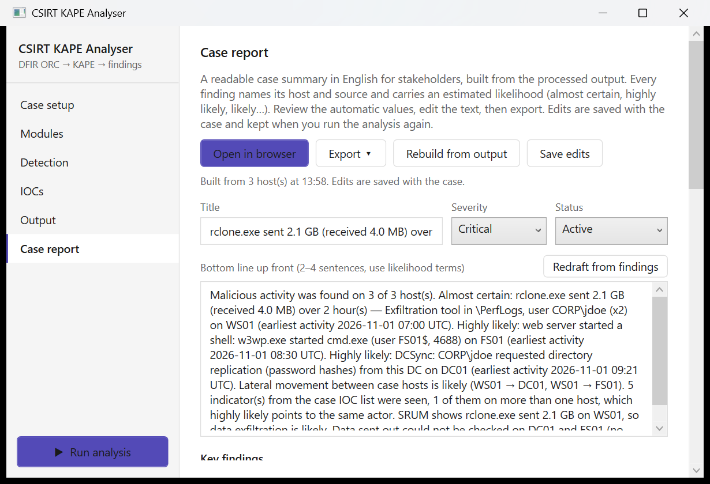

# CSIRT KAPE Analyser

A Windows desktop application for triaging Windows collections: **DFIR ORC** collects, **KAPE** (EZ Tools modules) parses, and this tool turns the module CSVs into per-host findings, a case summary and a case report for stakeholders. It is the Windows counterpart to the [CSIRT UAC Parser](https://github.com/JuggeM/CsirtParser.WPF) and uses the same layout and output style.



## Download

Get `KapeAnalyser.WPF.exe` from the [latest release](https://github.com/JuggeM/KapeAnalyser.WPF/releases/latest). It is a single self-contained file for 64-bit Windows: no install and no .NET runtime needed. The SHA256 is in the release notes. Windows Defender may flag it; see [Antivirus](#antivirus).

## What it does

1. **Finds hosts**: any folder under the case folder that holds EZ Tools CSVs, directly or in KAPE's category folders (`EventLogs`, `ProgramExecution`, `FileSystem`, `Registry`, …). Folders named after an ORC archive (`ORC_WorkStation_WS01_…`) or a KAPE timestamp folder work too.
2. **Analyses** each host's module output (below) and writes a QuickWins report plus CSVs for Timeline Explorer.
3. **Connects hosts**: lateral movement between case hosts, sources that logged on to several hosts, IOCs seen on several hosts, a case timeline, and a case IOC list searched in every CSV of every host.
4. **Reports**: a case report for stakeholders and per-host QuickWins in the same layout as the CSIRT UAC Parser.

| Source | KAPE module output | What it detects |
|---|---|---|
| EVTX | `*_EvtxECmd_Output.csv` | **Logons:** brute force (4625/4771/4776) and *succeeded* after failures, RDP logons (4624 type 10, 1149, 21/25), network logons from external IPs, type 9 logons, admin shares (5140/5145). **Accounts:** created and added to privileged groups. **Execution and persistence:** services (7045/4697), scheduled tasks (4698), process command lines (4688, Sysmon 1), shells started by a web server, Office, WMI or the print spooler (parent process), PowerShell (4104, 400/600/800), autorun registry writes (Sysmon 13), WMI subscriptions, BITS jobs. **Defence evasion:** Defender detections, exclusions and tampering, log clearing (1102/104), LSASS access (Sysmon 10). **Domain controller:** Kerberoasting (RC4) and DES tickets (4769), DCSync (4662), AdminSDHolder / delegation / shadow credential / GPO changes (5136), computer accounts created or given delegation by a user (4741/4742) |
| PREFETCH | `*_PECmd_Output.csv` | Known attacker and dual-use tools, executables run from staging folders |
| AMCACHE | `*_Amcache_*FileEntries.csv` | Same, with SHA1 |
| SHIMCACHE | `*AppCompatCache*.csv` | Same (times are file modification times) |
| REGISTRY | `*_RECmd_Batch_*_Output.csv` | Every value checked for tools, staging paths and attack command lines (UserAssist, BAM, RunMRU, services, …); autoruns; Defender exclusions; host name and IPs |
| LNK / JUMPLIST | `*_LECmd_Output.csv`, `*_AutomaticDestinations.csv` | Opened tools, malicious shortcut arguments, admin shares, removable media |
| MFT | `*_MFTECmd_$MFT_Output.csv` | Tools on disk, executables in staging folders, internet downloads (Zone.Identifier), timestomping (SI < FN), large archives, mass ransom notes |
| USNJRNL | `*_MFTECmd_$J_Output.csv` | Tools created, renamed or deleted; prefetch files created for tools; mass ransom notes |
| RECYCLEBIN | `*_RBCmd_Output.csv` | Deleted tools and large archives |
| SHELLBAGS | SBECmd output | Tool and loot folder names, admin shares |
| SRUM | `*_SrumECmd_NetworkUsages_Output.csv`, `*_AppResourceUseInfo_Output.csv` | Data sent out per app and user: known tools or staged binaries that uploaded data (exfiltration, e.g. "rclone.exe sent 2.1 GB"), other large uploads (normal uploaders such as OneDrive are ignored); tools that ran |

Run KAPE with the `!EZParser` compound module (or the individual modules) against the ORC collection.

## Screenshots

| | |
|---|---|
|  |  |
| Modules: which EZ Tools outputs to analyse | Case IOCs: paste indicators, defanged values are fixed |

## Requirements

- Windows 10/11
- The release exe needs nothing else. To build from source: .NET 8 SDK
- KAPE output from the EZ Tools modules (EvtxECmd, PECmd, AmcacheParser, AppCompatCacheParser, RECmd, LECmd, JLECmd, MFTECmd, RBCmd, SBECmd, SrumECmd)

## Case folder

```
CaseFolder\
├── Kape\
│   ├── WS01\EventLogs\…, ProgramExecution\…, FileSystem\…, Registry\…, SRUMDatabase\…
│   └── ORC_Server_FS01_20261101_120000\…
├── iocs.txt                ← case IOC list (IOCs panel)
└── Processed\
    ├── CaseSummary.txt     ← hosts ranked, lateral movement, case timeline, IOCs across hosts, top findings per host
    ├── CaseReport.html     ← case report (Case report panel → Open in browser)
    ├── CaseReport.json     ← your edits to the case report
    ├── CaseFindings.csv    ← all hosts' findings (Timeline Explorer)
    └── WS01\
        ├── QuickWins.txt / .rtf  ← host, key findings, IOCs seen in findings, coverage, logons, one table per source
        ├── Findings.csv    ← one row per finding, with detail and artifact
        ├── Logons.csv      ← inbound network/RDP/admin-share logons by source
        └── IocHits.csv     ← case IOC hits on this host
```

A host is processed once. To process it again, delete its folder in `Processed\`.

## Quickstart

1. **Case setup**: set the case name and analyst, and browse to the case folder. The hosts found are listed. Output goes to `Processed\` by default.
2. **Modules**: choose which EZ Tools outputs to analyse (all are on by default).
3. **Detection**: adjust the brute force threshold, extra keywords and whitelisted paths if needed.
4. **IOCs** (optional): paste known indicators from the ticket or threat intel.
5. **Run analysis**. The Output panel shows progress.
6. Start triage in each host's `QuickWins.rtf`, then `Processed\CaseSummary.txt`.
7. **Case report**: review the likelihoods, edit the bottom line, and export.

Headless (same output, no window):

```
KapeAnalyser.WPF.exe --case C:\Cases\X [--out <folder>] [--name <case>] [--analyst <name>]
```

Without `--analyst`, the Windows user name is used.

## QuickWins report

One report per host, in `QuickWins.txt` and laid out as tables in `QuickWins.rtf`:

- **Header**: host, IP, case, analyst, severity counts and the event log time span
- **Case IOC hits**: indicators from your list seen on this host, treat as CRITICAL until explained
- **Key findings**: every CRITICAL and HIGH finding across sources, by severity then time
- **IOCs seen in findings**: IPs, URLs, executables in staging folders, accounts and SHA1 hashes, with the sources each one appears in (more sources = stronger link)
- **Coverage**: per module, files, time range, Crit/High/Med and a status (review, minor, clean, not found). A source that wasn't collected shows as *not found*, so a missing finding is never mistaken for a clean source
- **Inbound logons**: network, RDP and admin-share logons by source
- **One section per source**, with the artifact (e.g. `Security.evtx`) and the command line or path under each finding
- **Pattern counts** per source


## Case IOC list

Paste indicators in the **IOCs** panel, several per line if you like. Defanged values (`203.0.113[.]45`, `hxxp://`) are fixed. The type is detected: IP, domain, URL, MD5/SHA1/SHA256, Windows path, file name. Prefix user names with `user:` and other file names with `file:`. Text after ` #` is a comment. The list is saved as `iocs.txt` in the case folder.

Every CSV of every host is searched, including columns no analyser reads. Hits go to the top of that host's QuickWins and to `IocHits.csv`, and raise the likelihood of matching findings in the case report. **Search processed hosts** runs the search again without re-analysing.

## Case summary and lateral movement

`Processed\CaseSummary.txt` is built from the processed output of every host, so it also covers hosts processed in earlier runs:

- **Hosts** ranked by critical, high and medium findings, with IOC hits and the top finding
- **Lateral movement**: logons whose source workstation or IP is another case host, and a case host's IP in another host's findings (for example `rclone copy \\10.10.1.30\Finance`). The direction is kept: a logon *from* WS01 to FS01 is `WS01 → FS01`
- **Sources logging on to several hosts** that are not case hosts (external IPs first)
- **Case IOC hits** per host and **IOCs across hosts**: indicators from findings seen on more than one host, which points to the same actor
- **Case timeline** of critical and high findings, and **top findings per host**

`CaseFindings.csv` holds every host's findings for Timeline Explorer.

## Case report

The **Case report** panel turns every host's `Findings.csv` into a readable English summary, like the CSIRT UAC Parser's:

- Each key finding gets a likelihood from the PHIA yardstick (almost certain, highly likely, likely…), based on its severity, whether another KAPE module on the same host saw the same indicator or tool (for example mimikatz in Prefetch, the USN journal and a 4688 event), and matches against the case IOC list. Select a row to see the basis and add a note; change the likelihood if you know more
- Every CRITICAL finding, the strongest 4 HIGH findings per host and anything linking case hosts are ticked by default. Change the selection with **Select all ≥ HIGH**, **Select all** and **Reset to default**
- A title, severity and a bottom line are drafted from the findings. The bottom line says what SRUM shows about data sent out, or which hosts had no SRUM output
- Intelligence gaps are detected from the data (missing module output, unknown host IPs, findings without a timestamp, no IOC list searched); add your own gaps and next steps
- **Open in browser** writes `Processed\CaseReport.html`; **Export ▾** saves HTML, Word (.docx, with real heading styles) or RTF. Print the HTML to get a PDF

Edits are saved to `Processed\CaseReport.json` and kept when you run the analysis again.

## Detection settings

- **Brute force threshold**: failed logons from one source before it is reported (default 10)
- **$MFT recency**: only list lower-severity files created within this many days of the newest file (0 = all)
- **Extra keywords**: names from the ticket or threat intel, flagged HIGH in file names, paths and command lines. Common attacker tools (mimikatz, rclone, PsExec, AnyDesk, SharpHound, …) are built in
- **Whitelisted path fragments**: never flagged, e.g. your EDR or deployment tool

## Test case and regression test

`tools\New-TestCase.ps1 -CaseFolder C:\Cases\KapeTest` writes synthetic EZ Tools output for three hosts (documentation-range IPs, fictional names). The story: RDP brute force on WS01, mimikatz, a backdoor account, rclone uploading about 2 GB (SRUM), PsExec to FS01, shadow copies deleted and ransom notes, a webshell on FS01, and Kerberoasting and DCSync against DC01.

After a build, `tools\Test-Detections.ps1` builds that case, runs the analyser headless and checks every detection it is built to trigger, and that noise such as OneDrive uploads is not flagged. It exits with code 1 when a check fails. Pass `-Exe` to test a published build.

## Building

```
dotnet build
```

Release build (single self-contained exe, as in the GitHub releases):

```
dotnet publish KapeAnalyser.WPF.csproj -c Release -r win-x64 --self-contained true -p:PublishSingleFile=true -p:IncludeNativeLibrariesForSelfExtract=true -o bin\Release\publish\win-x64
```

## Adding an analyser

1. Implement `IArtifactAnalyser` in `Analysers\`: `Source` (short tag), `Module` (shown in COVERAGE), `Accepts(fileName)` for the EZ Tools output name, `Analyse(csvPath, ctx)` per file and `Complete(ctx)` for per-host conclusions. Use `ctx.CoverageFor(Source)` so the module shows in COVERAGE, `ctx.Rules` for tool, staging-folder and command-line matching, and `FindingAggregator` to collapse repeated events into one finding with a count
2. Add it to `AnalyserRegistry.CreateAll()`
3. Add a toggle to `AnalyserConfig` and a card to `Views\ModulesView.xaml`
4. Add rows that trigger it to `tools\New-TestCase.ps1` and checks to `tools\Test-Detections.ps1`

## Antivirus

The detection rules contain attacker strings (tool names, mimikatz command syntax, AMSI-bypass markers), so Windows Defender may flag `KapeAnalyser.WPF.exe` (or the built `KapeAnalyser.WPF.dll`) as malicious and refuse to run it. As with other DFIR tools (KAPE and EZ Tools are often flagged too), add an antivirus exclusion for the folder you build or run it from, following your organisation's policy.

## Acknowledgements

Built on [KAPE](https://www.kroll.com/en/services/cyber-risk/incident-response-litigation-support/kroll-artifact-parser-extractor-kape) and [Eric Zimmerman's tools](https://ericzimmerman.github.io/) for parsing, and [DFIR ORC](https://github.com/DFIR-ORC/dfir-orc) (ANSSI) for collection. The likelihood terms follow the PHIA probability yardstick. The layout and the case report come from the [CSIRT UAC Parser](https://github.com/JuggeM/CsirtParser.WPF).

Development has been sped up with the help of [Claude](https://claude.com/claude-code) (Anthropic), used as a coding assistant. Detection logic and output are reviewed and tested against the synthetic test case before release.

## Licence

MIT. See [LICENSE.txt](LICENSE.txt).
