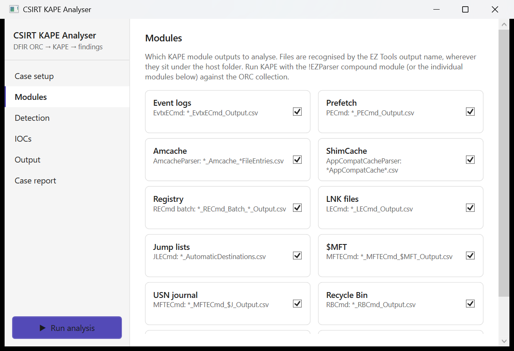
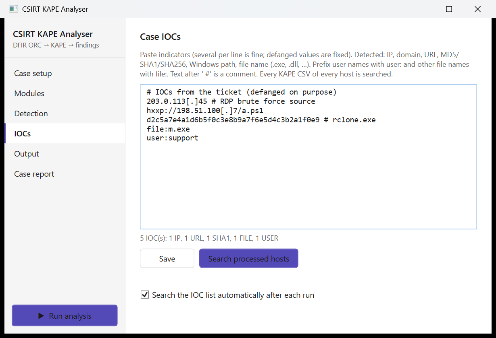
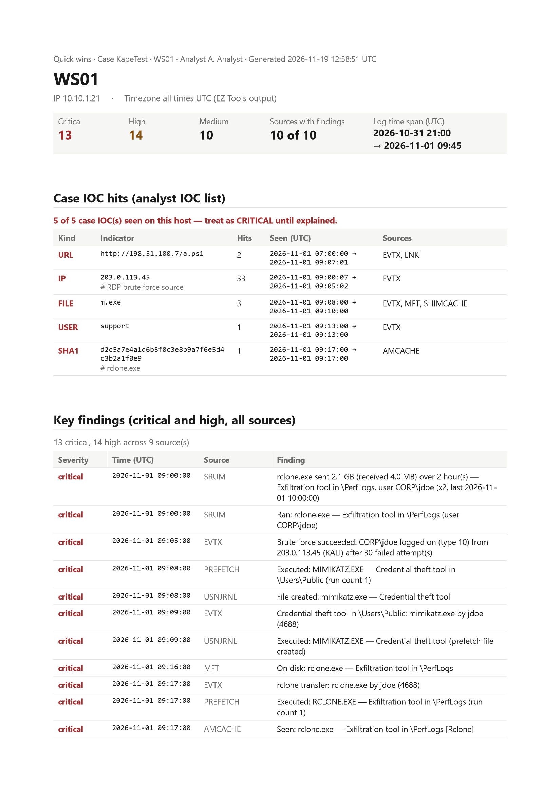

# CSIRT KAPE Analyser

[](https://github.com/JuggeM/KapeAnalyser.WPF/actions/workflows/build.yml)

A Windows desktop application for triaging Windows collections: **DFIR ORC** collects, **KAPE** (EZ Tools modules) parses, and this tool turns the module CSVs into per-host findings, a case summary and a case report for stakeholders. It is the Windows counterpart to the [CSIRT UAC Parser](https://github.com/JuggeM/CsirtParser.WPF) and uses the same layout and output style.


## Download

Get `KapeAnalyser.WPF.exe` and `rules.json` from the [latest release](https://github.com/JuggeM/KapeAnalyser.WPF/releases/latest) and keep them in the same folder. The exe is a single self-contained file for 64-bit Windows: no install and no .NET runtime needed. The SHA256 is in the release notes. Releases up to v0.3.0 have the rules built in, ship as the exe alone, and may be flagged by Windows Defender; see [Antivirus](#antivirus).

## What it does

1. **Finds hosts**: any folder under the case folder that holds EZ Tools CSVs, directly or in KAPE's category folders (`EventLogs`, `ProgramExecution`, `FileSystem`, `Registry`, …). Folders named after an ORC archive (`ORC_WorkStation_WS01_…`) or a KAPE timestamp folder work too.
2. **Analyses** each host's module output (below) and writes a QuickWins report plus CSVs for Timeline Explorer.
3. **Connects hosts**: lateral movement between case hosts, sources that logged on to several hosts, IOCs seen on several hosts, a case timeline, and a case IOC list searched in every CSV of every host.
4. **Reports**: a case report for stakeholders and per-host QuickWins in the same layout as the CSIRT UAC Parser.

| Source | KAPE module output | What it detects |
|---|---|---|
| EVTX | `*_EvtxECmd_Output.csv` | **Logons:** brute force (4625/4771/4776) and *succeeded* after failures, RDP logons (4624 type 10, 1149, 21/25), network logons from external IPs, type 9 logons, admin shares (5140/5145), password spray (many accounts, few tries each), account lockouts (4740; five or more accounts is high), possible pass-the-hash (NTLM network logon with key length 0) and NTLMv1 logons, desktop logons at an hour the host almost never sees (needs 20+ sessions as a baseline). **USB:** removable disks connected (Partition/Diagnostic 1006: model, serial, size, time). **Sessions:** logon to logoff (4624 → 4634/4647 by logon ID) and RDP sessions (LocalSessionManager 21 → 24/25 → 23), with duration; RDP sessions from external IPs are reported with how long they lasted. **WMI:** event filters, consumers and bindings (Sysmon 19/20/21), permanent and temporary subscriptions (WMI-Activity 5861/5860), providers loaded from unusual paths (5857). **Accounts:** created and added to privileged groups. **Execution and persistence:** services (7045/4697), scheduled tasks (4698), process command lines (4688, Sysmon 1), shells started by a web server, Office, WMI or the print spooler (parent process), PowerShell (4104, 400/600/800), autorun registry writes (Sysmon 13), WMI subscriptions, BITS jobs. **Defence evasion:** Defender detections, exclusions and tampering, log clearing (1102/104), LSASS access (Sysmon 10). **Domain controller:** Kerberoasting (RC4) and DES tickets (4769), DCSync (4662), AdminSDHolder / delegation / shadow credential / GPO changes (5136), computer accounts created or given delegation by a user (4741/4742) |
| PREFETCH | `*_PECmd_Output.csv` | Known attacker and dual-use tools, executables run from staging folders |
| AMCACHE | `*_Amcache_*FileEntries.csv` | Same, with SHA1 |
| SHIMCACHE | `*AppCompatCache*.csv` | Same (times are file modification times) |
| REGISTRY | `*_RECmd_Batch_*_Output.csv` | Every value checked for tools, staging paths and attack command lines (UserAssist, BAM, RunMRU, services, …); autoruns; Defender exclusions; host name and IPs. **Where this host connected out to:** RDP targets (Terminal Server Client, with the saved user name), mapped drives and network shares (Map Network Drive MRU, `Network\<letter>`, MountPoints2, typed UNC paths; admin shares such as `C$` are high). **USB:** storage devices (USBSTOR, with serial) and portable devices. A share or RDP target that is another case host counts as lateral movement, by IP or by name |
| LNK / JUMPLIST | `*_LECmd_Output.csv`, `*_AutomaticDestinations.csv` | Opened tools, malicious shortcut arguments, admin shares, removable media |
| MFT | `*_MFTECmd_$MFT_Output.csv` | Tools on disk, executables in staging folders, internet downloads (Zone.Identifier), timestomping (SI < FN), large archives, mass ransom notes |
| USNJRNL | `*_MFTECmd_$J_Output.csv` | Tools created, renamed or deleted; prefetch files created for tools; mass ransom notes. **Ransomware encryption:** many files renamed to the same new extension (100+ in 3+ folders, or 50+ that keep their old extension, e.g. `Q3.xlsx.lockfs`) is critical; a minute with 1000+ files overwritten or renamed is high. Common extensions (`.tmp`, `.bak`, `.crdownload`, …) are ignored |
| RECYCLEBIN | `*_RBCmd_Output.csv` | Deleted tools and large archives |
| SHELLBAGS | SBECmd output | Tool and loot folder names, admin shares |
| SRUM | `*_SrumECmd_NetworkUsages_Output.csv`, `*_AppResourceUseInfo_Output.csv` | Data sent out per app and user: known tools or staged binaries that uploaded data (exfiltration, e.g. "rclone.exe sent 2.1 GB"), other large uploads (normal uploaders such as OneDrive are ignored); tools that ran |
| BROWSER | SQLECmd: `*_ChromiumBrowser_HistoryVisits_*`, `*_ChromiumBrowser_Downloads_*`, `*_Firefox_History_*`, `*_Firefox_Downloads*` | Chrome, Edge and Firefox, per user (from the profile path). Visits to file sharing, paste, tunnel and remote-access sites (`suspiciousDomains` in rules.json) and to raw external IP addresses; downloads of known tools, into staging folders, and of executables or archives from a raw IP or a listed site |
| PSHISTORY | raw file: `Users\<user>\AppData\Roaming\Microsoft\Windows\PowerShell\PSReadLine\ConsoleHost_history.txt` | Every command typed in PowerShell, checked against the command-line rules (download cradles, encoded commands, Defender changes, history cleared, …), known tools and staging folders. The file has no timestamps, so these findings have none; the artifact column shows when the file was last written |
| WEBLOG | raw files: IIS `u_ex*.log` (W3C) and `u_nc*.log`, Tomcat `localhost_access_log*.txt` | Webshells (known shell names, scripts in upload folders, with the commands passed to them), scripts uploaded with PUT, Tomcat manager deploys, SQL injection, path traversal, command injection, XSS, Exchange ProxyShell probes, sensitive file probes, scanners by user agent, and web login brute force with success (as in the CSIRT UAC Parser). Grouped per client IP and type; an attack the server answered with 2xx/3xx is high (webshell: critical), otherwise medium. The patterns are the `web*` entries in rules.json |
| SIGMA | Hayabusa `dfir-timeline` CSV or Chainsaw `hunt --csv`, with `hayabusa` or `chainsaw` in the file name (or `sigma.csv`) | One finding per Sigma rule (and computer) with count and first/last time. Severity from the rule level (critical, high, medium; low = suspicious); informational hits are skipped. Columns are found by name, so any Hayabusa output profile works; timestamps with a UTC offset are converted to UTC. Chainsaw output has no level, so its hits are medium |

WMI tools and techniques are also in `rules.json`: `scrcons.exe` (runs WMI script consumers) and `mofcomp.exe` as tools, and remote process creation with `wmic /node:… process call create`, `Invoke-WmiMethod`/`Invoke-CimMethod … Win32_Process`, WMI persistence created from PowerShell, and compiled MOF files as command lines.

**Raw files** (PowerShell history, web server logs) are read from the host's KAPE folder in `Processed\` (KAPE target copies, such as `Processed\WS01\C\Users\…`) and from the host's extracted collection in `Decompressed\`: a folder with the same name as the host folder, or a DFIR ORC folder for the same host (`ORC_Server_FS01_…`). A file found in both places is read once. Only loose files are read: logs still inside an archive within the ORC collection are not opened. For browser history, include the `SQLECmd` module (part of `!EZParser`).

Run KAPE with the `!EZParser` compound module (or the individual modules) against the extracted ORC collection, with the case's `Processed\` folder as module destination (`--mdest`), one subfolder per host. Sigma results are optional: run Hayabusa (`hayabusa dfir-timeline -d <host's EVTX folder> -o Processed\<host>\hayabusa-timeline.csv`) or Chainsaw (`chainsaw hunt … --csv --output Processed\<host>\chainsaw`) and put the CSV in that host's folder.

## Screenshots

| | |
|---|---|
|  |  |
| Modules: which EZ Tools outputs to analyse | Case IOCs: paste indicators, defanged values are fixed |

## Requirements

- Windows 10/11
- The release exe needs nothing else. To build from source: .NET 8 SDK
- KAPE output from the EZ Tools modules (EvtxECmd, PECmd, AmcacheParser, AppCompatCacheParser, RECmd, LECmd, JLECmd, MFTECmd, RBCmd, SBECmd, SrumECmd, SQLECmd)

## Case folder

The case follows the collection pipeline: DFIR ORC archives are uploaded to `Uploads\` and extracted to `Decompressed\`, one folder per host named after the host the data was collected from. KAPE (`!EZParser`) processes each of those folders and writes its module output to a folder with the same name in `Processed\`. KapeAnalyser reads `Processed\` and writes its results to `Processed\Level2\`, so they never mix with the KAPE output.

```
CaseFolder\
├── Uploads\                ← ORC archives as received
├── Decompressed\           ← extracted ORC collections, one folder per host (KAPE's source)
│   └── WS01\…               ← also read directly for PowerShell history and web server logs
├── iocs.txt                ← case IOC list (IOCs panel)
└── Processed\              ← KAPE module output (KAPE --mdest), same folder name as in Decompressed\n    ├── WS01\EventLogs\…, ProgramExecution\…, FileSystem\…, Registry\…, SRUMDatabase\…
    ├── ORC_Server_FS01_20261101_120000\…
    └── Level2\             ← KapeAnalyser results
        ├── CaseSummary.txt     ← hosts ranked, lateral movement, case timeline, IOCs across hosts, top findings per host
        ├── CaseReport.html     ← case report (Case report panel → Open in browser)
        ├── CaseReport.json     ← your edits to the case report
        ├── CaseFindings.csv    ← all hosts' findings (Timeline Explorer)
        ├── CaseTracker.xlsx    ← critical/high findings as case tracker rows (Excel)
        └── WS01\
            ├── QuickWins.txt / .rtf  ← host, key findings, IOCs seen in findings, coverage, logons, one table per source
            ├── Findings.csv    ← one row per finding, with detail and artifact
            ├── Logons.csv      ← inbound network/RDP/admin-share logons by source
            ├── Sessions.csv    ← every logon session: user, type, source, start, end, duration, what ended it
            └── IocHits.csv     ← case IOC hits on this host
```

A host is processed once. To process it again, delete its folder in `Processed\Level2\`. The output folder can be changed in the **Output** panel (or with `--out`); it is never the case folder or `Processed\` itself.

Older cases without KAPE output in `Processed\` (for example `Case\Kape\WS01\…`) still work: the whole case folder is searched instead, skipping `Uploads\` and `Decompressed\`.

## Quickstart

1. **Case setup**: set the case name and analyst, and browse to the case folder. The hosts found in `Processed\` are listed; results go to `Processed\Level2\`.
2. **Modules**: choose which EZ Tools outputs to analyse (all are on by default).
3. **Detection**: adjust the brute force threshold, extra keywords and whitelisted paths if needed.
4. **IOCs** (optional): paste known indicators from the ticket or threat intel.
5. **Run analysis**. The Output panel shows progress.
6. Start triage in each host's `QuickWins.rtf`, then `Processed\Level2\CaseSummary.txt`.
7. **Case report**: review the likelihoods, edit the bottom line, and export.

Headless (same output, no window):

```
KapeAnalyser.WPF.exe --case C:\Cases\X [--out <folder>] [--name <case>] [--analyst <name>]
```

Without `--analyst`, the Windows user name is used.

## QuickWins report

One report per host, in `QuickWins.txt` and laid out as tables in `QuickWins.rtf`:

- **Header**: host, IP, case, analyst, severity counts and the event log time span
- **Case IOC hits**: indicators from your list seen on this host, treat as CRITICAL until explained
- **Key findings**: every CRITICAL and HIGH finding across sources, by severity then time
- **IOCs seen in findings**: IPs, URLs, executables in staging folders, accounts and SHA1 hashes, with the sources each one appears in (more sources = stronger link)
- **Coverage**: per module, files, time range, Crit/High/Med and a status (review, minor, clean, not found). A source that wasn't collected shows as *not found*, so a missing finding is never mistaken for a clean source
- **Inbound logons**: network, RDP and admin-share logons by source
- **Logon sessions**: interactive and RDP sessions with start, end and duration, external sources first. A session without an end was still open at collection, or the log rolled
- **One section per source**, with the artifact (e.g. `Security.evtx`) and the command line or path under each finding
- **Pattern counts** per source



## Case IOC list

Paste indicators in the **IOCs** panel, several per line if you like. Defanged values (`203.0.113[.]45`, `hxxp://`) are fixed. The type is detected: IP, domain, URL, MD5/SHA1/SHA256, Windows path, file name. Prefix user names with `user:` and other file names with `file:`. Text after ` #` is a comment. The list is saved as `iocs.txt` in the case folder.

Every CSV of every host is searched, including columns no analyser reads. Hits go to the top of that host's QuickWins and to `IocHits.csv`, and raise the likelihood of matching findings in the case report. **Search processed hosts** runs the search again without re-analysing.

## Case summary and lateral movement

`Processed\Level2\CaseSummary.txt` is built from the processed output of every host, so it also covers hosts processed in earlier runs:

- **Hosts** ranked by critical, high and medium findings, with IOC hits and the top finding
- **Lateral movement**: logons whose source workstation or IP is another case host, and a case host's IP in another host's findings (for example `rclone copy \\10.10.1.30\Finance`). The direction is kept: a logon *from* WS01 to FS01 is `WS01 → FS01`
- **Sources logging on to several hosts** that are not case hosts (external IPs first)
- **Case IOC hits** per host and **IOCs across hosts**: indicators from findings seen on more than one host, which points to the same actor
- **Case timeline** of critical and high findings, and **top findings per host**

`CaseFindings.csv` holds every host's findings for Timeline Explorer.

## Case report

The **Case report** panel turns every host's `Findings.csv` into a readable English summary, like the CSIRT UAC Parser's:

- Each key finding gets a likelihood from the PHIA yardstick (almost certain, highly likely, likely…), based on its severity, whether another KAPE module on the same host saw the same indicator or tool (for example mimikatz in Prefetch, the USN journal and a 4688 event), and matches against the case IOC list. Select a row to see the basis and add a note; change the likelihood if you know more
- Every CRITICAL finding, the strongest 4 HIGH findings per host and anything linking case hosts are ticked by default. Change the selection with **Select all ≥ HIGH**, **Select all** and **Reset to default**
- A title, severity and a bottom line are drafted from the findings. The bottom line says what SRUM shows about data sent out, or which hosts had no SRUM output
- Intelligence gaps are detected from the data (missing module output, unknown host IPs, findings without a timestamp, no IOC list searched); add your own gaps and next steps
- **Open in browser** writes `Processed\Level2\CaseReport.html`; **Export ▾** saves HTML, Word (.docx, with real heading styles) or RTF. Print the HTML to get a PDF

Edits are saved to `Processed\Level2\CaseReport.json` and kept when you run the analysis again.

### Case tracker export

**Export ▾ → Case tracker rows (.xlsx)** writes the ticked findings as rows for the case tracker spreadsheet, in its column order: `date/time, DataSource, hostsystem, host IP Address, Eventdescription, Account, SourceHost, SourceIP, Destination Host, Remote URL, Destination IP, Mitre Framework, Notes, Analyst, ReportHeading`. Every run also writes `Processed\Level2\CaseTracker.xlsx` with all critical and high findings.

- **date/time** is a real Excel date (UTC); **DataSource** is `KAPE: <module>`; **Notes** holds severity, likelihood, the finding's detail, your note and the host folder
- **Account**, **SourceHost/SourceIP** and **Destination Host/IP** are read from the finding text: "from 203.0.113.45 (KALI)" is the source and the host itself the destination; an address the host reached (`\\10.10.1.30\share`, `wmic /node:`, a download URL) is the destination. Check them before you paste; anything not stated in the finding is left empty
- **Mitre Framework** and **ReportHeading** are left empty for you to fill in
- The CSIRT UAC Parser writes the same file with the same columns, so Windows and Linux hosts land in the tracker the same way

## Detection rules (rules.json)

The tool names, staging folders, command-line techniques and suspicious shellbag folder names are not compiled in: they are read from `rules.json` next to `KapeAnalyser.WPF.exe` at the start of every run. Edit it to add a tool or a pattern without rebuilding; **Reload** in the Detection panel (or the next run) picks it up. Another file can be chosen in the Detection panel, or with `--rules <file>` when running headless.

```jsonc
{
  "tools": [
    { "name": "rclone", "category": "Exfiltration tool", "severity": "Critical", "group": "Exfiltration" },
    …
  ],
  "stagingFolders": [ { "pattern": "\\\\perflogs\\\\", "label": "\\PerfLogs" }, … ],
  "commandLines": [
    { "pattern": "vssadmin(\\.exe)?\\s+.*delete\\s+shadows", "label": "Shadow copies deleted (vssadmin)", "severity": "Critical" },
    …
  ],
  "shellbagFolderNames": "…",
  "webAttacks": [ { "label": "SQL injection", "pattern": "…" }, … ],
  "webSensitiveProbe": "…", "webUploadDirScript": "…", "webShellNames": "…", "webCommandParam": "…(?<cmd>[^&#]+)",
  "webScanners": [ { "tool": "sqlmap", "pattern": "sqlmap" }, … ],
  "suspiciousDomains": [ { "label": "File sharing (exfiltration)", "pattern": "(^|\\.)(mega\\.nz|…)$", "severity": "Medium" }, … ]
}
```

- **tools**: matched on the file name without extension (`procdump64.exe` → `procdump64`); names of 5 or more characters also match as a prefix (`rclone-v1.65`). A tool found in a staging folder is raised one severity level
- **stagingFolders**, **commandLines**, **shellbagFolderNames**: .NET regular expressions, case-insensitive. Paths are matched with backslashes, as they appear in the EZ Tools output (escape each one as `\\` in JSON)
- **webAttacks** (first match wins), **webSensitiveProbe**, **webUploadDirScript**, **webShellNames**, **webCommandParam** (needs a `cmd` group), **webScanners**: web server log rules, matched on the URL-decoded request (or the user agent for scanners)
- **suspiciousDomains**: matched on the host name of a visited or download URL
- **severity**: `Critical`, `High`, `Medium` or `Suspicious`
- `//` comments and trailing commas are allowed. A broken file stops the run with a message naming the entry (for example `commandLines #3: invalid pattern`) instead of analysing without rules

## Detection settings

- **Rules file**: which `rules.json` to use (empty = the one next to the exe), with **Open** and **Reload**
- **Brute force threshold**: failed logons from one source before it is reported (default 10)
- **$MFT recency**: only list lower-severity files created within this many days of the newest file (0 = all)
- **Extra keywords**: names from the ticket or threat intel, flagged HIGH in file names, paths and command lines, for this case only. Permanent additions belong in `rules.json`
- **Whitelisted path fragments**: never flagged, e.g. your EDR or deployment tool

## Test case and regression test

`tools\New-TestCase.ps1 -CaseFolder C:\Cases\KapeTest` writes synthetic EZ Tools output for three hosts (documentation-range IPs, fictional names). The story: RDP brute force on WS01 and a 42-minute RDP session from the internet, mimikatz, a backdoor account, WMI persistence and remote WMIC execution, rclone uploading about 2 GB (SRUM), PsExec to FS01, shadow copies deleted and ransom notes, a webshell on FS01, and Kerberoasting and DCSync against DC01. WS01 also has a Hayabusa CSV (local time +01:00, with an informational hit that must be skipped) and FS01 a Chainsaw CSV. From WS01's registry: an RDP target, a mapped share and `\\FS01\C$`, and a USB stick that also shows up as connected in the event log; a month of daytime desk sessions and one logon at 02:40. DC01 sees a password spray from WS01 with six lockouts, and FS01 an NTLM logon without a session key (pass-the-hash shape). FS01's $J has 150 files renamed to `.lockfs` across five share folders and a burst of 1100 overwrites in one minute; its IIS log (only in `Decompressed\`) shows the webshell, sqlmap and an Exchange probe, and its Tomcat log a manager brute force, a WAR deploy and a JSP shell. WS01 has a PowerShell history (in both `Processed\` and `Decompressed\`, so it must be read once) and Chrome history with MEGA visits and downloads from a raw IP.

After a build, `tools\Test-Detections.ps1` builds that case, runs the analyser headless and checks every detection it is built to trigger, and that noise such as OneDrive uploads is not flagged. It exits with code 1 when a check fails. Pass `-Exe` to test a published build. GitHub Actions runs the build and this test on every push and pull request (`.github/workflows/build.yml`); the badge at the top shows the latest result.

## Building

```
dotnet build
```

`rules.json` is copied next to the exe by every build and publish; it is never bundled into the single file.

Release build (single self-contained exe, as in the GitHub releases):

```
dotnet publish KapeAnalyser.WPF.csproj -c Release -r win-x64 --self-contained true -p:PublishSingleFile=true -p:IncludeNativeLibrariesForSelfExtract=true -o bin\Release\publish\win-x64
```

## Adding an analyser

1. Implement `IArtifactAnalyser` in `Analysers\` (or `IRawFileAnalyser` for files that are not EZ Tools CSVs: `AcceptsRaw(path)` instead of `Accepts`): `Source` (short tag), `Module` (shown in COVERAGE), `Accepts(fileName)` for the EZ Tools output name, `Analyse(csvPath, ctx)` per file and `Complete(ctx)` for per-host conclusions. Use `ctx.CoverageFor(Source)` so the module shows in COVERAGE, `ctx.Rules` for tool, staging-folder and command-line matching (the lists live in `rules.json`), and `FindingAggregator` to collapse repeated events into one finding with a count
2. Add it to `AnalyserRegistry.CreateAll()`
3. Add a toggle to `AnalyserConfig` and a card to `Views\ModulesView.xaml`
4. Add rows that trigger it to `tools\New-TestCase.ps1` and checks to `tools\Test-Detections.ps1`

## Antivirus

The detection rules contain attacker strings (tool names, credential-dumping command syntax, AMSI-bypass markers). Since they moved to `rules.json`, the executable no longer contains them: a build that Windows Defender blocked as `HackTool:Win32/Mimikatz` before the change runs unflagged after it. Releases up to v0.3.0 still have the rules compiled in and may be flagged.

`rules.json` and `tools\New-TestCase.ps1` are text files with the same kind of strings. Defender did not flag `rules.json` in testing. PowerShell's AMSI scans scripts as they run, which is why the test case uses harmless command lines. If your antivirus quarantines a file anyway, add an exclusion for that folder, following your organisation's policy.

## Acknowledgements

Built on [KAPE](https://www.kroll.com/en/services/cyber-risk/incident-response-litigation-support/kroll-artifact-parser-extractor-kape) and [Eric Zimmerman's tools](https://ericzimmerman.github.io/) for parsing, and [DFIR ORC](https://github.com/DFIR-ORC/dfir-orc) (ANSSI) for collection. The likelihood terms follow the PHIA probability yardstick. The layout and the case report come from the [CSIRT UAC Parser](https://github.com/JuggeM/CsirtParser.WPF).

Development has been sped up with the help of [Claude](https://claude.com/claude-code) (Anthropic), used as a coding assistant. Detection logic and output are reviewed and tested against the synthetic test case before release.

## Licence

MIT. See [LICENSE.txt](LICENSE.txt).
